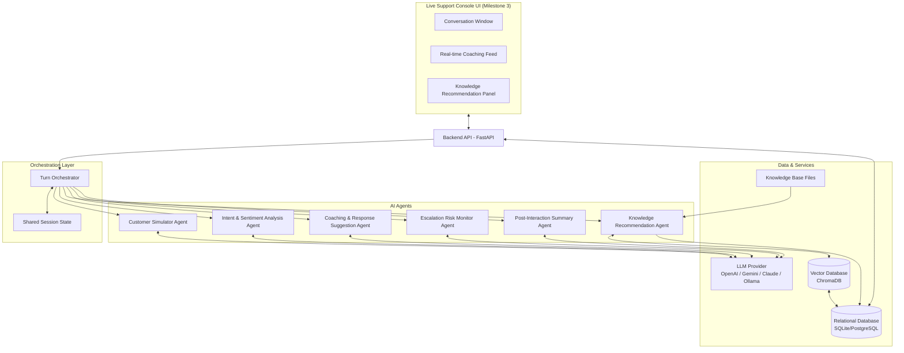
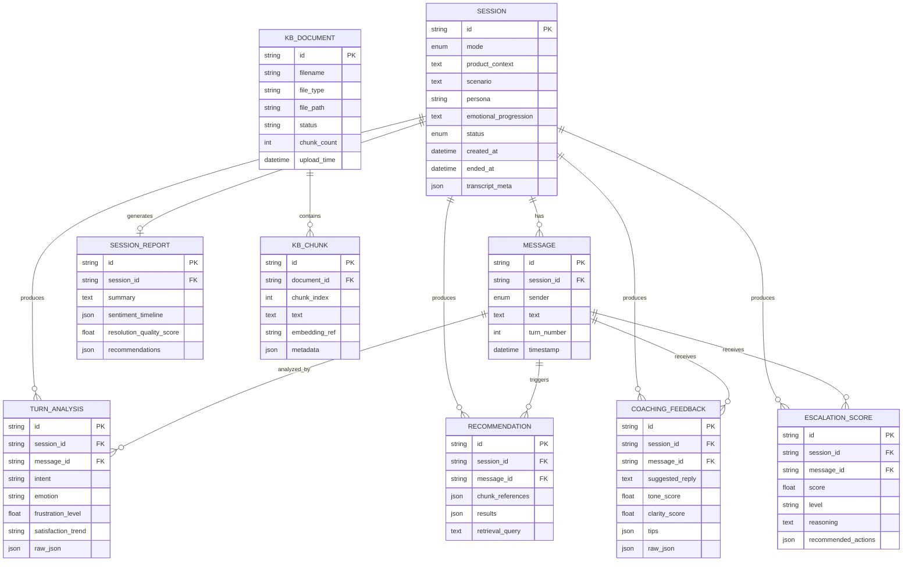

# AI Customer Support Coaching Assistant — Milestone 1 Design Document

## 1. Architecture Diagram



**Connections summary**
- **UI ↔ Backend API**: session creation, KB upload, message send, turn results, end session, report retrieval.
- **API ↔ Orchestrator**: dispatches per-turn pipeline and end-of-session summary.
- **Orchestrator ↔ Agents**: invokes agents with structured inputs/outputs; maintains shared state (history, latest analyses).
- **Agents ↔ LLM**: all agents except retrieval-only parts of Knowledge Recommendation use LLM for structured JSON outputs.
- **Knowledge Recommendation ↔ Vector DB**: embed query, similarity search, return top-k chunks.
- **Backend ↔ Relational DB**: persist sessions, messages, turn outputs, KB metadata, reports.
- **KB ingestion**: files → extract → chunk → embed → index in vector DB with metadata in relational DB.

## 2. Agent Specification Table

| Agent | Purpose | Inputs | Outputs (fields) | When it runs | Dependencies |
|---|---|---|---|---|---|
| **Customer Simulator Agent** | Generates the next realistic customer message based on scenario, persona, and emotional progression. | `session_id`, `product_context`, `scenario`, `persona`, `emotional_progression`, `conversation_history`, `last_agent_reply` (optional) | `message_text`, `intended_emotion`, `intensity` (1-5), `escalation_signal` (bool), `notes` | On demand in Simulator mode to produce next customer turn (and can seed first message) | Session config, conversation history |
| **Intent and Sentiment Analysis Agent** | Identifies customer intent, emotional state, frustration, and satisfaction trend per message. | `message_id`, `message_text`, `conversation_history`, `product_context` | `intent`, `intent_confidence`, `emotion`, `frustration_level` (0-1), `satisfaction_trend` (improving/stable/declining), `key_phrases`, `rationale` | Every customer turn (before/during coaching pipeline) | Customer message; history for trend |
| **Knowledge Recommendation Agent** | Retrieves relevant KB content for the current turn using RAG. | `query_text` (customer message + recent context), `session_id`, `top_k`, `filters` (optional) | `recommendations[]` (`chunk_id`, `document_id`, `source`, `section`, `text`, `score`), `retrieval_query`, `confidence` | Every customer turn | Indexed KB (chunks+embeddings). Can run in parallel with Intent & Sentiment. |
| **Coaching and Response Suggestion Agent** | Suggests agent replies, evaluates tone/clarity, and gives improvement tips. | `customer_message`, `conversation_history`, `intent_sentiment_output`, `knowledge_recommendations`, `draft_agent_reply` (optional) | `suggested_reply`, `alternative_replies[]`, `tone_score` (0-1), `clarity_score` (0-1), `empathy_score` (0-1), `tips[]`, `risk_flags[]` | Every customer turn (after analysis & retrieval) | Intent & Sentiment output, Knowledge recommendations |
| **Escalation Risk Monitor Agent** | Scores escalation likelihood with reasoning and recommended strategies. | `conversation_history`, `intent_sentiment_output`, `previous_risk_scores`, `coaching_output` (optional) | `risk_score` (0-1), `risk_level` (low/medium/high), `triggers[]`, `reasoning`, `recommended_actions[]` | Every customer turn (after analysis; can incorporate coaching) | Intent & Sentiment output, history/trend |
| **Post-Interaction Summary Agent** | Produces end-of-session summary, sentiment journey, resolution quality score, and coaching recommendations. | `session`, `full_conversation_history`, `all_turn_analyses`, `all_coaching_feedback`, `all_escalation_scores`, `outcome` (optional) | `summary`, `sentiment_journey[]` (`turn`, `emotion`, `frustration`, `note`), `resolution_quality_score` (0-100), `resolution_status`, `strengths[]`, `improvements[]`, `personalized_coaching[]`, `metrics` | Once at session end | Full history and all per-turn outputs |

## 3. Orchestration Flow

### Per-turn flow (customer message received)
1. **Ingest message**: source = Simulator / Manual / Replay. Persist `Message` (sender=customer) and update session state.
2. **Parallel stage A** (independent):
   - **Intent & Sentiment Analysis Agent** analyzes current message + history.
   - **Knowledge Recommendation Agent** retrieves top-k chunks using message (+ recent context).
3. **Parallel/Dependent stage B** (needs stage A):
   - **Coaching & Response Suggestion Agent** uses intent/sentiment + recommendations (+ optional draft reply).
   - **Escalation Risk Monitor Agent** uses intent/sentiment + history + previous risk (can also consider coaching flags).
   *These two can run in parallel once stage A outputs are available.*
4. **Persist & publish**: store `TurnAnalysis`, `Recommendation`, `CoachingFeedback`, `EscalationScore`; return aggregated turn result to UI.
5. **UI refresh**: update conversation, coaching feed, knowledge panel. If `risk_level == high` (or score ≥ threshold), trigger alert overlay.
6. **(Simulator mode only)**: if session continues, Customer Simulator Agent generates next customer message (can be triggered after agent reply or auto-step in replay-like simulation).

### End-of-session flow
1. Mark session status `ended`.
2. Run **Post-Interaction Summary Agent** on full history + all per-turn outputs.
3. Persist `SessionReport` and return to UI.

### Notes
- **Parallelism**: ISA and KRA in parallel per turn; CRA and ERM in parallel after ISA/KRA. PSA runs alone at end.
- **Shared state**: orchestrator holds conversation history, latest outputs, and session config in DB/memory cache.
- **Failure handling**: validate agent JSON; retry with repair prompt on malformed output; fall back to safe defaults (e.g. empty recommendations, neutral sentiment) and log errors.

## 4. Data Models and ER Diagram

### Entity Relationship Diagram


> Note: Milestone 1 implements `SESSION`, `MESSAGE`, `KB_DOCUMENT`, `KB_CHUNK` fully; turn-output/report tables are scaffolded in the database for Milestones 2–4.

### Session
| Field | Type | Notes |
|---|---|---|
| id | string (UUID) | PK |
| mode | enum | `simulator` \| `manual` \| `replay` |
| product_context | string | product/service handled |
| scenario | string | customer problem |
| persona | string? | required for simulator (patient/impatient/confused/angry etc.) |
| emotional_progression | string/json? | intended progression for simulator |
| status | enum | `created` \| `active` \| `ended` |
| created_at | datetime | |
| ended_at | datetime? | |
| metadata/transcript_meta | json? | transcript info, etc. |

### Message
| Field | Type | Notes |
|---|---|---|
| id | string (UUID) | PK |
| session_id | string (FK) | |
| sender | enum | `customer` \| `agent` \| `system` |
| text | text | |
| turn_number | int | increments per conversational exchange/turn |
| timestamp | datetime | |

### TurnAnalysis
| Field | Type | Notes |
|---|---|---|
| id | string (UUID) | PK |
| session_id | string (FK) | |
| message_id | string (FK) | analyzed customer message |
| intent | string | |
| intent_confidence | float | 0-1 |
| emotion | string | |
| frustration_level | float | 0-1 |
| satisfaction_trend | string | improving/stable/declining |
| key_phrases | json | list |
| rationale | text | |
| raw_json | json | full agent output |
| created_at | datetime | |

### Recommendation
| Field | Type | Notes |
|---|---|---|
| id | string (UUID) | PK |
| session_id | string (FK) | |
| message_id | string (FK) | triggering message |
| chunk_references | json | list of chunk ids |
| results | json | chunks with text, source, score |
| retrieval_query | text | |
| created_at | datetime | |

### CoachingFeedback
| Field | Type | Notes |
|---|---|---|
| id | string (UUID) | PK |
| session_id | string (FK) | |
| message_id | string (FK) | |
| suggested_reply | text | |
| tone_score | float | 0-1 |
| clarity_score | float | 0-1 |
| empathy_score | float | 0-1 |
| tips | json | list |
| raw_json | json | |
| created_at | datetime | |

### EscalationScore
| Field | Type | Notes |
|---|---|---|
| id | string (UUID) | PK |
| session_id | string (FK) | |
| message_id | string (FK) | |
| score | float | 0-1 |
| level | string | low/medium/high |
| reasoning | text | |
| recommended_actions | json | list |
| triggers | json | list |
| raw_json | json | |
| created_at | datetime | |

### KBDocument
| Field | Type | Notes |
|---|---|---|
| id | string (UUID) | PK |
| filename | string | |
| file_type | string | pdf/txt/md |
| file_path | string | stored path |
| status | string | uploaded/indexed/failed |
| chunk_count | int | |
| upload_time | datetime | |
| metadata | json | |

### KBChunk
| Field | Type | Notes |
|---|---|---|
| id | string (UUID) | PK |
| document_id | string (FK) | |
| chunk_index | int | |
| text | text | |
| embedding_ref | string | vector DB id |
| metadata | json | source file, section/heading, page etc. |

### SessionReport
| Field | Type | Notes |
|---|---|---|
| id | string (UUID) | PK |
| session_id | string (FK, unique) | |
| summary | text | |
| sentiment_timeline | json | journey points |
| resolution_quality_score | float | 0-100 |
| resolution_status | string | resolved/unresolved/escalated/unknown |
| recommendations | json | personalized coaching |
| metrics | json | counts, avg scores |
| raw_json | json | |
| created_at | datetime | |

## 5. API Outline (with Request/Response Structures)

| Method | Endpoint | Purpose | Key request fields | Key response fields |
|---|---|---|---|---|
| POST | `/api/sessions` | Create/configure session | `mode`, `product_context`, `scenario`, `persona?`, `emotional_progression?`, `transcript?` | `id`, `mode`, `product_context`, `scenario`, `status`, `created_at`, ... |
| GET | `/api/sessions/{session_id}` | Get session config/state | - | session object |
| GET | `/api/sessions` | List sessions | - | array of session objects |
| POST | `/api/sessions/{session_id}/end` | End session & generate report | `outcome?` | status, report id/summary |
| POST | `/api/sessions/{session_id}/messages` | Add/send message (customer or agent) | `sender`, `text` | message, turn results (if customer) |
| GET | `/api/sessions/{session_id}/messages` | Get conversation history | - | messages[] |
| GET | `/api/sessions/{session_id}/turns/{message_id}` | Get all agent outputs for a turn | - | analysis, recommendations, coaching, escalation |
| GET | `/api/sessions/{session_id}/report` | Get post-interaction report | - | report object |
| POST | `/api/kb/documents` | Upload KB document (PDF/TXT/MD) | multipart form-data: `file` | `id`, `filename`, `file_type`, `status`, `chunk_count`, `upload_time` |
| GET | `/api/kb/documents` | List KB documents | - | array of document objects |
| POST | `/api/kb/documents/{doc_id}/reindex` | Reindex a document | - | updated document object |
| POST | `/api/kb/retrieve` | Retrieve relevant chunks | `query`, `top_k?`, `session_id?` | `query`, `top_k`, `count`, `results[]` |
| GET | `/api/health` | Health check | - | `status`, `milestone` |

### Example request/response structures (Milestone 1)

**Create session (Simulator) — Request**
```json
{
  "mode": "simulator",
  "product_context": "ShopNest e-commerce support",
  "scenario": "Customer charged twice for subscription",
  "persona": "impatient",
  "emotional_progression": "frustrated -> angry if unresolved -> relieved if refund confirmed"
}
```
**Create session — Response (200)**
```json
{
  "id": "b3b0d7e0-1f6d-4e4a-9d7f-2b5d2a1f3c11",
  "mode": "simulator",
  "product_context": "ShopNest e-commerce support",
  "scenario": "Customer charged twice for subscription",
  "persona": "impatient",
  "emotional_progression": "frustrated -> angry if unresolved -> relieved if refund confirmed",
  "status": "created",
  "transcript_meta": null,
  "created_at": "2026-11-12T10:00:00Z",
  "ended_at": null
}
```

**Upload KB document — Request**: `multipart/form-data` with field `file` (PDF/TXT/MD).  
**Upload KB document — Response (200)**
```json
{
  "id": "doc_9f1...",
  "filename": "refund_policy.md",
  "file_type": "md",
  "status": "indexed",
  "chunk_count": 8,
  "error": null,
  "upload_time": "2026-11-12T10:05:00Z"
}
```

**Retrieve — Request**
```json
{ "query": "I was charged twice for my subscription. What should I do?", "top_k": 5 }
```
**Retrieve — Response (200)**
```json
{
  "query": "I was charged twice for my subscription. What should I do?",
  "top_k": 5,
  "count": 5,
  "results": [
    {
      "chunk_id": "chunk_uuid",
      "document_id": "doc_uuid",
      "source": "refund_policy.md",
      "section": "Duplicate or Incorrect Charges",
      "text": "If you were charged twice for the same order...",
      "score": 0.8731
    }
  ]
}
```

*Milestone 1 implements: session create/get/list, KB upload/list/reindex, KB retrieve, health. Message/turn/report endpoints are outlined for subsequent milestones.*

## 6. Agent Output Schemas (Sample JSON)

### 6.1 Customer Simulator Agent
```json
{
  "message_text": "Hi, I was charged twice for my subscription this month and I'm really frustrated.",
  "intended_emotion": "frustrated",
  "intensity": 4,
  "escalation_signal": false,
  "notes": "Customer opens with billing issue; persona impatient, progression moving toward anger if unresolved."
}
```

### 6.2 Intent and Sentiment Analysis Agent
```json
{
  "intent": "billing_dispute_duplicate_charge",
  "intent_confidence": 0.96,
  "emotion": "frustrated",
  "frustration_level": 0.78,
  "satisfaction_trend": "declining",
  "key_phrases": ["charged twice", "subscription", "this month"],
  "rationale": "Customer explicitly reports duplicate billing and expresses frustration."
}
```

### 6.3 Knowledge Recommendation Agent
```json
{
  "retrieval_query": "charged twice subscription billing duplicate charge refund",
  "confidence": 0.88,
  "recommendations": [
    {
      "chunk_id": "chk_123",
      "document_id": "doc_billing",
      "source": "billing_faq.md",
      "section": "Duplicate Charges",
      "text": "If you see a duplicate charge, first confirm whether one is a pending authorization...",
      "score": 0.91
    },
    {
      "chunk_id": "chk_124",
      "document_id": "doc_refunds",
      "source": "refund_policy.md",
      "section": "Refund Timelines",
      "text": "Approved refunds are returned to the original payment method within 5-7 business days...",
      "score": 0.84
    }
  ]
}
```

### 6.4 Coaching and Response Suggestion Agent
```json
{
  "suggested_reply": "I'm sorry you were charged twice—that's understandably frustrating. I can help sort this out. Could you confirm the last 4 digits of the card and the date/amount of both charges so I can verify and start a refund if it's a duplicate?",
  "alternative_replies": [
    "Thanks for letting us know. I understand how concerning a duplicate charge is. Let me check this for you—can you share the transaction dates and amounts?"
  ],
  "tone_score": 0.9,
  "clarity_score": 0.88,
  "empathy_score": 0.92,
  "tips": [
    "Acknowledge frustration explicitly before asking for details.",
    "State the next action clearly (verify and start refund if duplicate)."
  ],
  "risk_flags": []
}
```

### 6.5 Escalation Risk Monitor Agent
```json
{
  "risk_score": 0.62,
  "risk_level": "medium",
  "triggers": ["billing_issue", "expressed_frustration", "money_impact"],
  "reasoning": "Duplicate charge with frustration increases escalation risk; no supervisor request yet but requires prompt ownership.",
  "recommended_actions": [
    "Acknowledge impact and apologize clearly",
    "Provide concrete next steps and timeline",
    "Offer escalation path if not resolved quickly"
  ]
}
```

### 6.6 Post-Interaction Summary Agent
```json
{
  "summary": "Customer reported a duplicate subscription charge. Agent verified transactions, explained pending authorization vs duplicate, and initiated refund. Frustration decreased after clear ownership.",
  "sentiment_journey": [
    {"turn": 1, "emotion": "frustrated", "frustration": 0.78, "note": "Opened with billing complaint"},
    {"turn": 3, "emotion": "concerned", "frustration": 0.45, "note": "Agent acknowledged and gathered info"},
    {"turn": 5, "emotion": "neutral", "frustration": 0.2, "note": "Resolution steps confirmed"}
  ],
  "resolution_quality_score": 86,
  "resolution_status": "resolved",
  "strengths": ["Empathy shown early", "Clear explanation of next steps"],
  "improvements": ["Could provide refund timeline proactively"],
  "personalized_coaching": [
    "When billing issues arise, include expected timelines in the first substantive reply."
  ],
  "metrics": {"turns": 5, "avg_frustration": 0.48, "max_risk": 0.62}
}
```

## 7. RAG Design Decisions (Milestone 1)

| Decision | Choice | Rationale |
|---|---|---|
| Chunk size | ~450 tokens target (char-based approximation ~1800 chars) | Balances context completeness with retrieval precision for FAQ/policy docs. |
| Chunk overlap | ~60 tokens (~240 chars) | Preserves continuity across boundaries and reduces missed answers spanning chunks. |
| Split strategy | Paragraph/heading-aware recursive splitting; keep headings with content when possible | Support docs are structured; headings improve semantic relevance. |
| Embedding model | `sentence-transformers/all-MiniLM-L6-v2` (local default) | No API cost, fast, good baseline; pluggable to provider embeddings via config. |
| Vector DB | ChromaDB (persistent local) | Simple setup, metadata filtering, persists across runs; suitable for Milestone 1. |
| Top-k | 5 | Provides enough context without overwhelming prompt; adjustable per query. |
| Distance/score | Cosine similarity (Chroma default for normalized embeddings) exposed as relevance score | Intuitive relevance ranking; return source and score for transparency. |
| Query formulation | Customer message + optional recent context | Improves retrieval for follow-up turns. |
| Failure handling | Graceful errors for unreadable/empty files; skip empty chunks; return empty results with message | Robust ingestion and retrieval. |

## 8. Technology Stack (Agreed for Milestone 1)

- **Backend**: Python 3.11+, FastAPI
- **Relational DB**: SQLite (default, via SQLAlchemy) — easy local setup; configurable to PostgreSQL
- **Vector DB**: ChromaDB (persistent)
- **Embeddings**: sentence-transformers `all-MiniLM-L6-v2` (local) by default; OpenAI embeddings optional
- **PDF extraction**: pypdf
- **LLM**: configurable (OpenAI/Gemini/Claude/Ollama) for future milestones; Milestone 1 RAG and session config work without LLM
- **UI**: deferred (Milestone 3), API-first now
- **Testing/tools**: pytest, Git

## 9. Milestone 1 Scope Notes
- Implemented now: design artifacts, session configuration module, KB ingestion (upload/extract/chunk/embed/index), retrieval API, sample KB, retrieval test set, README.
- Scaffolded for later milestones: data models for turn outputs/reports, agent interfaces/orchestrator placeholders, API routes for messages/reports (can be extended).
- No confidential/real customer data used; sample domain is fictional e-commerce (ShopNest).
